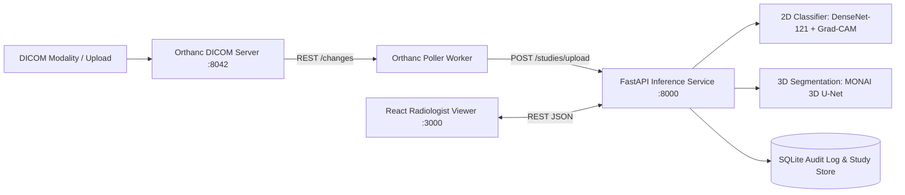

# System Architecture & Data Flow

## High-Level Architecture (Mermaid)

## Component Responsibilities

1. **Data & Versioning Layer ([DVC](https://dvc.org/)):** `dvc.yaml` and `params.yaml` track raw datasets ([CheXpert](https://stanfordmlgroup.github.io/competitions/chexpert/), [NIH ChestX-ray14](https://docs.cloud.google.com/healthcare-api/docs/resources/public-datasets/nih-chest), [Medical Segmentation Decathlon](http://medicaldecathlon.com/)), preprocessing outputs, model checkpoints, and evaluation metrics.
2. **PACS Ingestion ([Orthanc](https://www.orthanc-server.com/)):** Stores DICOM studies via C-STORE/REST/DICOMweb (`docker/orthanc.json`). `backend/orthanc_poller.py` polls `/changes` for `StableStudy` events and triggers automated inference.
3. **AI Inference & Explainability (`ml/` & `backend/inference_service.py`):** Runs transfer-learning 2D classification with [Grad-CAM](https://arxiv.org/abs/1610.02391) localization and [MONAI](https://project-monai.github.io/) 3D U-Net volumetric segmentation.
4. **Human-in-the-Loop Review (`frontend/src/App.jsx` & `backend/database.py`):** Displays scan, overlay controls, confidence scores, Approve/Reject actions, and an append-only SQLite audit log.
