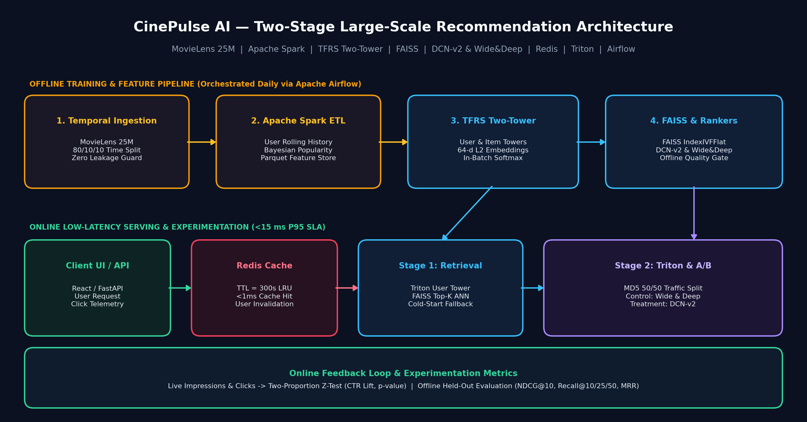
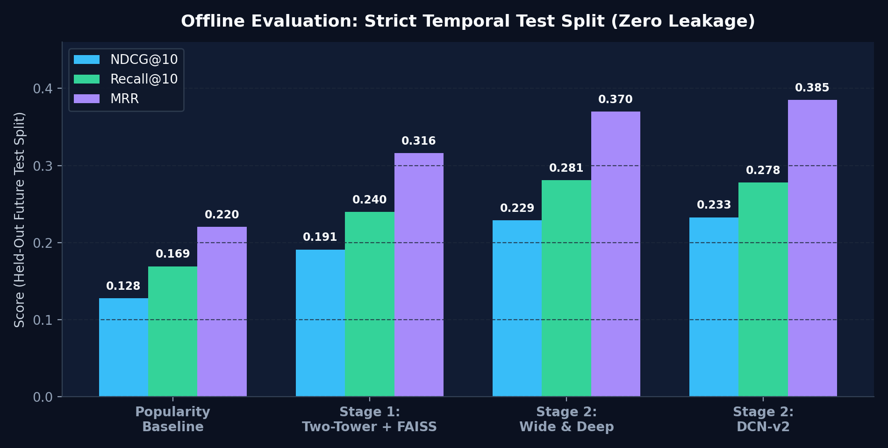

# CinePulse AI — Large-Scale Personalized Recommendation Engine (AIML-03)

[](https://www.python.org/)
[](https://fastapi.tiangolo.com/)
[](#architecture)
[](#offline-benchmark-results)
[](#running-tests)

A production-style **two-stage personalized recommendation engine** inspired by Netflix and Amazon architectures. Stage 1 retrieves top candidate items in sub-millisecond latency via a **Two-Tower retrieval model + FAISS**, and Stage 2 precisely re-ranks candidates using **DCN-v2** vs. **Wide & Deep**, complete with **cold-start fallbacks**, **Redis caching**, **NVIDIA Triton Inference Server** configs, an **Apache Airflow** daily retraining DAG, **online A/B testing**, and an interactive **CinePulse AI** web UI.

---

## Architecture Overview



### End-to-End 7-Milestone Coverage
1. **Strict Temporal Data Splitting (`data/prepare_movielens.py`)**: Cleans MovieLens 25M (or deterministic local benchmark schema), deduplicates user-item pairs, and splits strictly by timestamp (**80% train / 10% val / 10% test**) with automated zero-leakage assertions.
2. **Apache Spark Feature Engineering (`spark/feature_engineering.py`)**: Builds user rolling interaction history, Bayesian-smoothed item popularity, recency-decayed trending scores, and multi-hot genre encodings into Parquet feature tables (with an identical Pandas local mirror for laptop execution).
3. **Two-Tower Retrieval Model (`models/two_tower_tfrs.py` & `models/local_engine.py`)**: Separate User and Item towers trained with in-batch softmax / collaborative + content fusion into L2-normalized embeddings.
4. **FAISS Nearest-Neighbor Indexing (`retrieval/faiss_index.py`)**: Indexes L2-normalized item vectors with `IndexFlatIP`, `IndexIVFFlat`, or `IndexHNSWFlat` (with automatic NumPy exact-IP fallback).
5. **Stage-2 Deep Ranking (`models/ranking_models.py` & `models/local_engine.py`)**: Compares **DCN-v2** (explicit polynomial feature crosses + deep MLP) against **Wide & Deep** (linear memorization + deep generalization) trained with negative sampling.
6. **Cold-Start Fallbacks & Redis Caching (`serving/cold_start.py`, `serving/redis_cache.py`)**: Serves zero-history users with Bayesian popularity + recency trending, genre-onboarded users with 70/30 TF-IDF cosine + quality blending, and caches hot user feeds in Redis (300s TTL, automatic LRU fallback).
7. **Triton Serving, Airflow DAG & Online A/B Testing (`triton/`, `airflow/dags/`, `ab_testing/`)**: Includes Triton KServe V2 `config.pbtxt` files (dynamic batching + ensemble), a 5-task daily Airflow retraining DAG with an NDCG/Recall quality gate, and deterministic MD5 50/50 A/B traffic splitting with live CTR lift & two-proportion z-test significance.

---

## Offline Benchmark Results (Strict Temporal Test Split)



Evaluated on **21,324 chronologically split interactions** (17,059 train / 2,132 val / 2,133 held-out future test; 120 curated films across 19 genres; 400 users including a 15-user cold-start cohort):

| Stage / Model | NDCG@10 | Recall@10 | Recall@25 | Recall@50 | MRR | P50 Latency |
| :--- | :---: | :---: | :---: | :---: | :---: | :---: |
| Popularity Baseline | 0.1276 | 0.1693 | 0.3712 | — | 0.2204 | — |
| Stage 1: Two-Tower + FAISS | 0.1910 | 0.2397 | 0.4720 | **0.7444** | 0.3160 | **0.048 ms** |
| Stage 2: Wide & Deep (Control) | 0.2287 | **0.2809** | **0.5225** | — | 0.3698 | 0.080 ms |
| **Stage 2: DCN-v2 (Treatment)** | **0.2328** | 0.2780 | 0.5208 | — | **0.3851** | 0.086 ms |

- **+82.4% NDCG@10 lift** for DCN-v2 over the Popularity Baseline (`0.2328` vs `0.1276`).
- **+21.9% NDCG@10 lift** from Stage-2 DCN-v2 re-ranking over Stage-1 Two-Tower retrieval alone (`0.2328` vs `0.1910`).
- **+4.1% MRR gain** for DCN-v2 over Wide & Deep (`0.3851` vs `0.3698`), validating explicit cross-network feature interactions.

---

## Quick Start

### Option A: Windows PowerShell One-Click Launch (Recommended for Local Demo)
```powershell
.\run_local.ps1
```
Then open **http://127.0.0.1:8000** for the interactive **CinePulse AI UI** and **http://127.0.0.1:8000/docs** for Swagger API docs.

### Option B: Manual Python Setup (Mac / Linux / Windows)
```bash
pip install -r requirements-lite.txt
PYTHONPATH=. python data/prepare_movielens.py --synthetic --num-users 400
PYTHONPATH=. python spark/feature_engineering.py --force-local
PYTHONPATH=. python models/local_engine.py
uvicorn backend.main:app --host 127.0.0.1 --port 8000 --reload
```

### Option C: Full-Scale MovieLens 25M Mode
1. Download `ml-25m.zip` from [GroupLens MovieLens 25M](https://grouplens.org/datasets/movielens/25m/) and extract to `data/raw/ml-25m/`.
2. Install full ML dependencies: `pip install -r requirements.txt`
3. Run:
   ```bash
   PYTHONPATH=. python data/prepare_movielens.py --raw-dir data/raw/ml-25m
   PYTHONPATH=. python spark/feature_engineering.py
   PYTHONPATH=. python models/two_tower_tfrs.py --epochs 5
   ```

### Option D: Docker Compose (Redis + FastAPI + Optional Triton & Airflow)
```bash
docker compose up --build                # Core serving stack (FastAPI + Redis)
docker compose --profile full up --build # Full MLOps stack (+ Triton + Airflow)
```

---

## Running Tests
```bash
PYTHONPATH=. python -m unittest tests/test_pipeline.py -v
```

---

## Documentation
- [Architecture Deep Dive](docs/ARCHITECTURE.md)
- [REST API Documentation](docs/API_DOCUMENTATION.md)
- [Individual Intern Reflection Template](docs/INTERN_REFLECTION_TEMPLATE.md)
