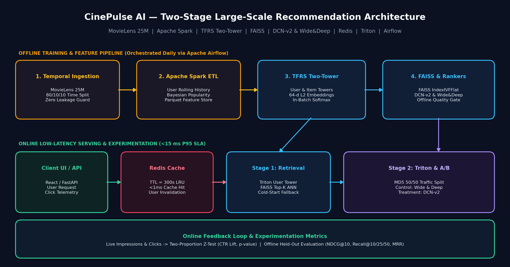

# System Architecture — CinePulse AI (AIML-03)

## 1. Two-Stage Funnel Design
Scoring every catalog item with a deep neural network on every request does not scale to millions of items under a <50 ms SLA. CinePulse AI decouples recommendation into two specialized stages:

1. **Stage 1 — Candidate Retrieval (Two-Tower + FAISS)**
   - **Goal**: High recall over the entire catalog in < 5 ms.
   - **Mechanism**: User features and Item features are encoded independently into L2-normalized vectors. Item embeddings are pre-indexed offline in **FAISS** (`IndexIVFFlat` / `IndexHNSWFlat` / `IndexFlatIP`). At request time, only the User Tower runs, followed by a single inner-product ANN lookup returning the top 50–200 unseen candidates.
2. **Stage 2 — Deep Re-Ranking (DCN-v2 vs. Wide & Deep)**
   - **Goal**: High precision (NDCG@10, MRR, CTR) over the Stage-1 candidate pool.
   - **Mechanism**: Joins user-item cross features (Two-Tower cosine similarity, genre overlap, Jaccard similarity, Bayesian quality, log popularity, recency-decayed trend, user positive rate) and scores all candidates in a single batched forward pass.

## 2. Cold-Start & Caching Strategy
- **Zero-History Users**: Served via Bayesian-smoothed rating (`m = 20` prior) blended 65/35 with exponentially recency-decayed trending score.
- **Genre-Onboarded Users**: Served via TF-IDF inverse-genre-frequency cosine similarity blended 70/30 with Bayesian quality.
- **Redis Caching**: Keyed by `recs:v1:u:{user_id}:m:{variant}:k:{top_k}` with 300s TTL and explicit per-user invalidation on new interaction events.

## 3. Production MLOps (Triton + Airflow + A/B Testing)
- **NVIDIA Triton Inference Server**: `triton/model_repository/` defines `user_tower`, `dcn_ranker`, `wide_deep_ranker`, and `ensemble_recommender` with dynamic batching (`preferred_batch_size: [64, 128, 256]`).
- **Apache Airflow**: `airflow/dags/retraining_pipeline_dag.py` runs daily at 02:00 UTC with an automated **Offline Quality Gate** blocking Triton hot-reload if `NDCG@10 < 0.20` or `Recall@50 < 0.40`.
- **Online A/B Testing**: Deterministic MD5 hash bucketing splits traffic 50/50 between `wide_and_deep` (Control) and `dcn_v2` (Treatment), evaluating CTR lift with a two-proportion z-test (`p < 0.05`).
